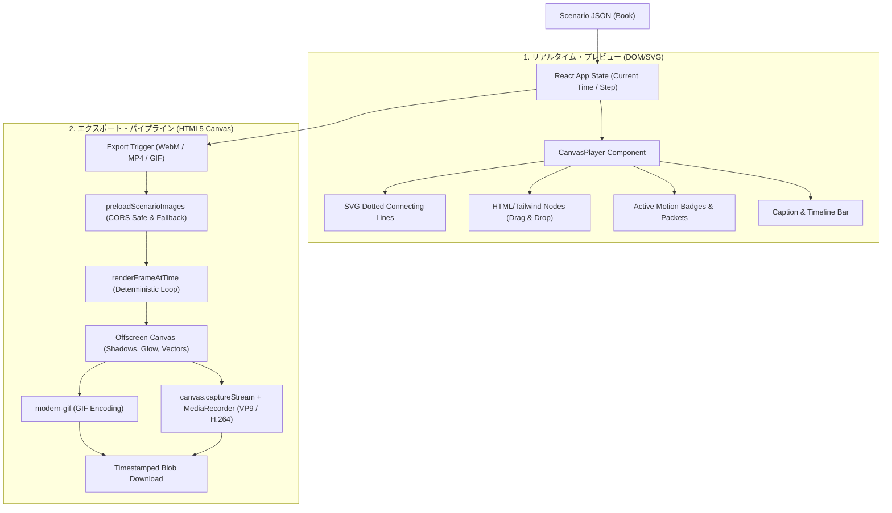

# アーキテクチャ設計書 (Architecture & Technical Decisions)

本ドキュメントは、DessinFlux の全体設計、レンダリングパイプライン、外部アセット解決の仕組み、および今後の拡張（Tauri等のデスクトップ化）に関する技術的判断基準をまとめたものです。

---

## 1. システム概要と設計思想

DessinFlux は、動画クリエイターが「解説動画やプレゼンに挟むアニメーション図解」を直感的かつ手軽に作成できることを目指しています。

### コアな設計方針
1. **宣言的シナリオ定義**: アニメーションの時系列・オブジェクト配置をシンプルな JSON で記述でき、AIによる自動生成にも親和性が高いこと。
2. **ゼロ設定・即座のプレビュー**: インストール直後からブラウザ上で数ミリ秒単位でシーク・再生確認ができること。
3. **動画編集連携の重視**: 通常の GIF だけでなく、YMM4（ゆっくりMovieMaker4）や Premiere Pro、DaVinci Resolve に直接取り込める **背景透過 WebM (VP9)** および汎用 **MP4** を標準サポートすること。

---

## 2. デュアルレンダリング・パイプライン

DessinFlux では、**「ブラウザ上のリアルタイム・プレビュー」** と **「動画・GIFのオフライン・エクスポート」** で異なるレンダリングエンジンを採用しつつ、描画結果が完全に一致するよう設計されています。

### なぜDOMとCanvasを分けたのか？
- **DOM / SVG（プレビュー）**:
  - CSSアニメーション、Tailwind による柔軟なスタイリング、マウスドラッグによる座標更新が極めて高速・低負荷で動作します。
- **HTML5 Canvas 2D（エクスポート）**:
  - 端末の描画フレームレートやCPU負荷に依存せず、`1/fps` 秒刻みの仮想時間を進めながら正確に1フレームずつ描画・記録できます。
  - 発光エフェクト（`shadowBlur`）、波紋リング、アスペクト比を維持した画像描画（`drawContainedImage`）を Canvas 側でも忠実に再実装し、プレビューとの見た目の差異をゼロにしています。

---

## 3. アセット読み込みとフォールバック設計

### CORS問題の克服
ブラウザ上で Canvas に画像を描画し、それを `getImageData()` や `canvas.captureStream()` で取り出す際、クロスオリジン制約（CORS）が厳格に適用されます。

- **問題の背景**:
  Vite 開発サーバー等の静的ファイル配信では、ローカルの同一オリジン画像であっても `crossOrigin = "anonymous"` を不用意に設定すると CORS エラーとしてブロックされる現象が発生します。
- **解決アプローチ (`loadSingleImage`)**:
  1. 相対パスや同一オリジン画像に対しては `crossOrigin` を設定せず通常ロード。
  2. 外部URLに対しては `crossOrigin = "anonymous"` でロード。
  3. 万が一失敗した場合はモードを反転して1回リトライ。
  4. `vite.config.ts` に `server.cors = true` を設定してサーバー側でも防御。

### 二重フォールバック機構
外部アセットが存在しない環境や、画像リンク切れ（404）が発生した場合でも、アニメーションが壊れないよう設計されています。

1. **デフォルトアバターの常時プリロード**:
   - `/actors/avatar-bot.svg`（ボット・システム・解説役用）
   - `/actors/avatar-user.svg`（ユーザー・端末用）
2. **自動切り替え**:
   - プレビューの `` 要素の `onError` イベント
   - エクスポーターの `preloadScenarioImages` におけるエラーハンドラ
   の両方でフォールバックパスへ自動置換されます。

---

## 4. 将来の拡張性：Tauri（デスクトップアプリ化）の検討

「ブラウザ環境の制約を解除するために Tauri（Rustベースのデスクトップフレームワーク）を採用すべきか？」についての検討とトレードオフです。

### Tauri 採用のメリット
1. **ローカルファイルへのダイレクトアクセス**:
   - `public/actors/` フォルダに画像をコピーすることなく、PC内の任意のフォルダにある画像・動画・音声アセットをファイルダイアログから直接参照可能。
2. **FFmpeg ネイティブ連携**:
   - ブラウザの `MediaRecorder`（ブラウザ実装依存）を使わず、FFmpeg バイナリを直接呼び出してエンコード可能。
   - ProRes (透過動画)、H.265/HEVC、AV1、音声（ナレーションBGM）合成など、より高度な動画フォーマット出力が可能。
3. **ブラウザのメモリ・性能制限の回避**:
   - 4K（3840x2160）などの超高解像度レンダリングや、数分間に及ぶ長尺アニメーションの出力が安定。

### デメリットおよび現状維持の理由
1. **環境構築・ビルドコストの増大**:
   - Rust ツールチェーンの導入や、クロスプラットフォーム（Windows, Mac, Linux）向けのインストーラー生成が必要。
2. **起動とポータビリティの低下**:
   - 現状の Web 版（Vite + React）は `npm run dev` だけで即座に起動し、GitHub Pages などの静的ホスティングで誰でもブラウザから利用できる手軽さがある。
3. **現在のユースケースとの整合性**:
   - 現在の DessinFlux は「数秒〜十数秒の短い解説アニメーション図解を出力し、動画編集ソフト側に配置する」という用途が中心であり、現状の WebM (VP9透過) / MP4 / GIF 出力で十分な品質とパフォーマンスを達成できている。

### 結論とロードマップ
- **フェーズ1（現在）**: **Webアプリケーション（Vite + React）のまま推進**。手軽さと素早い機能追加（UI/UX改善、シナリオエディタ拡充）を最優先とする。
- **フェーズ2（将来）**: 以下の要求が生まれた段階で、既存のフロントエンド資産をそのまま Tauri に移植する：
  - 音声（VOICEVOXやナレーション音声）とアニメーションの自動リップシンク機能
  - PC内フォルダからのドラッグ＆ドロップによる素材インポート
  - FFmpeg を用いた 4K / 60fps / ProRes 形式の直接出力
